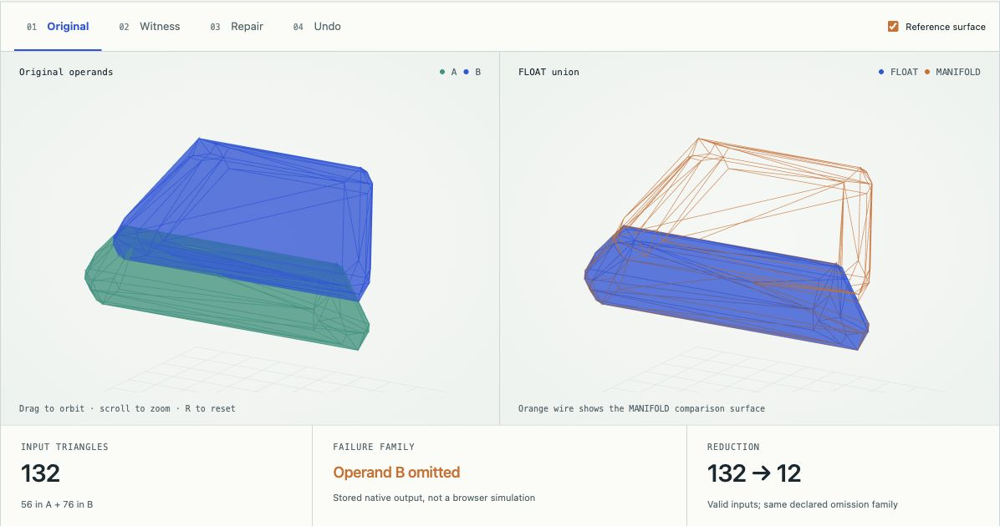

# I build things that show their work.

I'm Nazeeh Abdul-Hadi. I make tools for the parts of software and science that are hard to see: a branch in a running program, the shape of a geometry failure, a native object's surviving state, or a plausible answer that turns out to be wrong. You can open the work, change the view, and inspect what supports the claim.

### Start with a broken mesh

**132 triangles → a 12-triangle witness.** [Explore Solidrift](https://nazeeh111.github.io/Solidrift/) · [Read the source](https://github.com/nazeeh111/Solidrift). Orbit the original failure, step through 60 accepted reductions, follow the witness back to the full model, test a repair, then undo it. The geometry and Boolean outputs are from a recorded native run; the browser is an explorer.

## Pick a question

**Can compiled code outlive its original host?** [Capsulith's image workbench](https://nazeeh111.github.io/Capsulith/studio/image.html) calls a prepared ARM64 QOI decoder, displays the returned pixels, then restores its native pixel heap in a fresh worker. [Source and scope](https://github.com/nazeeh111/Capsulith).

**Can a failed program take a different path?** [Aetiory's recorded diagnosis](https://nazeeh111.github.io/Aetiory/) shows an earlier Python return changed and both outcomes replayed. The browser displays retained evidence; the live fork runs locally on trusted synchronous Unix Python. [Source](https://github.com/nazeeh111/Aetiory).

**Can a good fit still be false?** [Caustryn's radio lab](https://nazeeh111.github.io/Caustryn/demo/) lets you inspect a recorded synthetic case in which a held-position check passes at a point **3.488 m from the generator's truth**. The example tests an assumption, not real-world sensing accuracy. [Source](https://github.com/nazeeh111/Caustryn).

## More to open

- **Execution and recovery:** [Forkwake](https://github.com/nazeeh111/Forkwake#run-it) saves a live JavaScript or WebAssembly decision; [Rewynth](https://github.com/nazeeh111/Rewynth#run-it) compares ARM64 return values and bounded memory; [Reclay](https://nazeeh111.github.io/Reclay/relocation.html) learns supported binary layouts from related files; [Eidryl](https://nazeeh111.github.io/Eidryl/) infers a model of a trusted typed API.
- **Measurement and reconstruction:** [EchoSight](https://github.com/nazeeh111/EchoSight/blob/backend/implementation/docs/MEASURED_NLOS.md) reconstructs published ultrasound measurements; [EchoAtlas](https://github.com/nazeeh111/EchoAtlas) explores Mac acoustic gesture sensing; [WiPose](https://github.com/nazeeh111/WiPose) separates recorded Wi-Fi pose inference from a hardware-free demo.
- **Checks you can carry:** [Certloom](https://nazeeh111.github.io/Certloom/) independently checks exact numerical error bounds; [SchemaRehearsal](https://github.com/nazeeh111/SchemaRehearsal#keep-search-working-after-a-migration) replays app behavior across SQLite migrations; [Kinetyl](https://nazeeh111.github.io/Kinetyl/) checks motion-path labels and framing; [Sweepforge](https://nazeeh111.github.io/Sweepforge/) checks modeled linkage clearance.
- **Create and teach:** [SolidFrame](https://nazeeh111.github.io/SolidFrame/) is an interactive CAD workbench; [Syllune](https://nazeeh111.github.io/Syllune/) is a private math studio. [Browse every repository](https://github.com/nazeeh111?tab=repositories).

## Elsewhere in open source

- [Pattern Projector #431](https://github.com/Pattern-Projector/pattern-projector/pull/431): merged viewport-outline fix for zoom, pan, rotation, reflection, and calibration. Projection hardware was not tested.
- [awesome-sqlite #10](https://github.com/Airsequel/awesome-sqlite/pull/10): merged Tools-list and contribution-format improvement after maintainer review.
- [GitHub advisory GHSA-wvqv-fj8w-qmhm](https://github.com/advisories/GHSA-wvqv-fj8w-qmhm): credited as Analyst for correcting the Django package and affected-version mapping. [Accepted change](https://github.com/github/advisory-database/pull/9912).
- [Binaryen.js #131](https://github.com/AssemblyScript/binaryen.js/pull/131): submitted a binding correction with JavaScript and TypeScript regression tests; upstream acceptance is pending.

*Some projects use recorded or simulated data, and others run native code locally or in the browser. Each repository states what was actually measured, what was replayed, and where its claims stop. GitHub upload dates reflect publication from local Git workspaces, not the full development timeline.*
