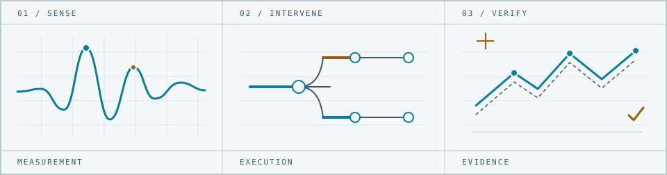

<picture>
  <source media="(prefers-color-scheme: dark)" srcset="assets/field-sheet-dark.svg">
  <source media="(prefers-color-scheme: light)" srcset="assets/field-sheet-light.svg">
  
</picture>

# Nazeeh Abdul-Hadi

**Make hidden behavior visible. Make the result runnable.**

I work across software systems, physical sensing, and scientific computing. I like the moment an invisible behavior becomes something you can point at: an execution branch, a recovered state, a measured volume, or a counterexample. The projects below are built around that moment, with runnable examples and explicit limits.

## Open a workbench

**[Capsulith](https://github.com/nazeeh111/Capsulith)** · Keep original ARM64 instructions and initialized objects, then call selected methods from a portable Node or browser API. [Run the image workbench](https://nazeeh111.github.io/Capsulith/studio/image.html) with a small PNG or QOI file and inspect returned pixel bytes. The browser executes a prepared native component through the credited Unicorn.js engine; it is a scoped extraction demo, not universal binary recovery.

**[Aetiory](https://github.com/nazeeh111/Aetiory)** · Fork a failed Python run at an earlier return, test an alternate value, and replay both outcomes without changing the source. [Explore a recorded diagnosis](https://nazeeh111.github.io/Aetiory/). The live fork requires trusted synchronous Unix Python; the browser presents retained evidence.

**[Caustryn](https://github.com/nazeeh111/Caustryn)** · Fit one explanation to a radio receiver sweep, then predict withheld positions without refitting. [Inspect the recorded experiments](https://nazeeh111.github.io/Caustryn/demo/), including a counterfeit that passes both checks. Its original simulation does not establish performance on measured scenes.

**[Solidrift](https://github.com/nazeeh111/Solidrift)** · Reduce a broken Blender Boolean to a small, valid witness and trace the witness back to the original operands. [Explore the geometry](https://nazeeh111.github.io/Solidrift/). The native example shrinks 132 input triangles to 12 while retaining the omission; repairs are tested on the full model.

## Other ways in

### Preserve and change execution

- [Forkwake](https://github.com/nazeeh111/Forkwake#try-it) saves a live JavaScript or WebAssembly decision so one workflow can take multiple futures.
- [Rewynth](https://github.com/nazeeh111/Rewynth#run-it) compares ARM64 returns and bounded memory state, exposing edits that a return value alone misses.
- [Reclay](https://nazeeh111.github.io/Reclay/relocation.html) learns supported binary layouts from related files and exports a guarded standalone editor.
- [Eidryl](https://nazeeh111.github.io/Eidryl/) infers an executable model of a trusted typed API, including hidden modes revealed by stateful histories.

### Measure and reconstruct

- [EchoSight](https://github.com/nazeeh111/EchoSight/blob/backend/implementation/docs/MEASURED_NLOS.md) reconstructs published ultrasound measurements into inspectable volumes. Its measured route and separate simulated room route have different evidence.
- [EchoAtlas](https://github.com/nazeeh111/EchoAtlas) explores Mac speaker-and-microphone gesture controls with calibration and signal inspection. Live-hand accuracy still needs testing.
- [WiPose](https://github.com/nazeeh111/WiPose) links Wi-Fi channel measurements to 2D pose estimation. The repo separates recorded inference from its hardware-free signal demo.

### Carry the check with the result

- [Certloom](https://nazeeh111.github.io/Certloom/) packages exact error bounds for a numerical solve with an independent browser checker.
- [SchemaRehearsal](https://github.com/nazeeh111/SchemaRehearsal#keep-search-working-after-a-migration) replays application behavior across SQLite migrations, catching changes that row checks miss.
- [Kinetyl](https://nazeeh111.github.io/Kinetyl/) compiles label placement and camera framing across a whole motion path while retaining an editable storyboard.
- [Sweepforge](https://nazeeh111.github.io/Sweepforge/) fits a one-motor linkage to timed motion and checks modeled full-cycle clearances.

For more work across CAD, audio, optics, physics, and local developer tools, use the [repository list](https://github.com/nazeeh111?tab=repositories). Each project's README states its supported scope, setup, provenance, and verification limits.

## Work beyond my own repositories

- Fixed the zoom-out viewport outline in [Pattern Projector #431](https://github.com/Pattern-Projector/pattern-projector/pull/431), accounting for pan, rotation, reflection, and calibration. Merged; projection hardware was not tested.
- Clarified the existing Tools list and contribution format in [awesome-sqlite #10](https://github.com/Airsequel/awesome-sqlite/pull/10). Merged after maintainer review.
- Corrected a Django package and affected-version mapping in a [published GitHub advisory](https://github.com/advisories/GHSA-wvqv-fj8w-qmhm); the advisory credits me as Analyst. [Accepted change](https://github.com/github/advisory-database/pull/9912).
- Submitted a [Binaryen.js binding correction](https://github.com/AssemblyScript/binaryen.js/pull/131) with JavaScript and TypeScript regression tests. Submission is distinct from upstream acceptance.

**Publication note:** Projects were published in batches from local Git workspaces. GitHub upload dates are publication dates, not a development timeline. Simulated, recorded, and measured results are identified separately in their repositories.
