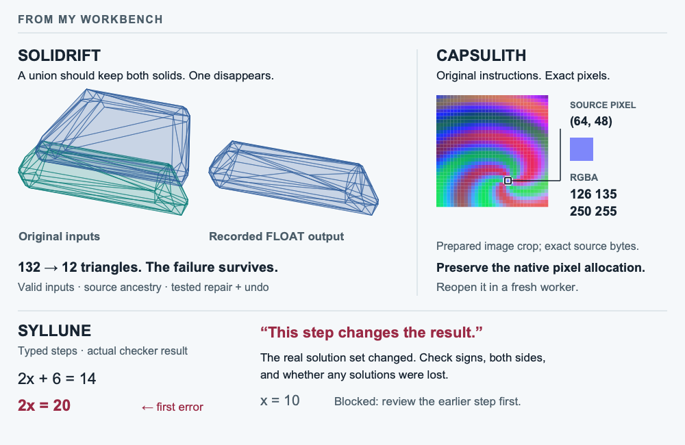

# A mesh, a pixel, a math step

I'm Nazeeh. I like to open an answer back up. Shrink a mesh failure, follow pixels through preserved code, or find the math step that changed the result.

**Open a working example:** [Inspect the missing-body case](https://nazeeh111.github.io/Solidrift/) · [Open the native image workbench](https://nazeeh111.github.io/Capsulith/studio/image.html) · [Check a math step](https://nazeeh111.github.io/Syllune/)

<picture>
  <source media="(max-width: 600px) and (prefers-color-scheme: dark)" srcset="assets/workbench-mobile-dark.png">
  <source media="(max-width: 600px) and (prefers-color-scheme: light)" srcset="assets/workbench-mobile-light.png">
  <source media="(prefers-color-scheme: dark)" srcset="assets/workbench-dark.png">
  
</picture>

*Three separate projects. Syllune ink is pictured; its hosted step checker uses typed text. [Image sources](assets/workbench-provenance.md).*

## The work behind the objects

- **[Solidrift](https://github.com/nazeeh111/Solidrift):** a Blender Boolean dropped one body. Inspect its recorded reduction from 132 triangles to a 12-triangle witness, then explore the recorded repair and undo. The image above shows the *original* input and FLOAT output; a new native run needs local Blender.
- **[Capsulith](https://github.com/nazeeh111/Capsulith):** run a prepared ARM64 QOI component in your browser, compare returned RGBA pixels, then restore its native image allocation in a fresh worker. The pictured crop is from its prepared source image.
- **[Syllune](https://github.com/nazeeh111/Syllune):** write in a private notebook, check supported typed steps, and practice from the first error. The pictured ink is from the current studio; handwriting recognition requires the optional local Mac companion.

Elsewhere, [Caustryn](https://nazeeh111.github.io/Caustryn/demo/?case=exact-counterfeit) exposes a synthetic radio-fit check that accepts a wrong point; [Certloom](https://github.com/nazeeh111/Certloom) checks stored linear equations independently of its solver; and [SolidFrame](https://nazeeh111.github.io/SolidFrame/) makes editable browser CAD that exports STEP and STL. [Browse the full project index](https://nazeeh111.github.io/).

## Work accepted elsewhere

My [Pattern Projector viewport fix](https://github.com/Pattern-Projector/pattern-projector/pull/431) was merged across zoom, pan, rotation, reflection, and calibration; projection hardware was not tested. GitHub credited me as Analyst on an [advisory correction](https://github.com/github/advisory-database/pull/9912) to Django's package and affected-version mapping ([GHSA-wvqv-fj8w-qmhm](https://github.com/advisories/GHSA-wvqv-fj8w-qmhm)).
