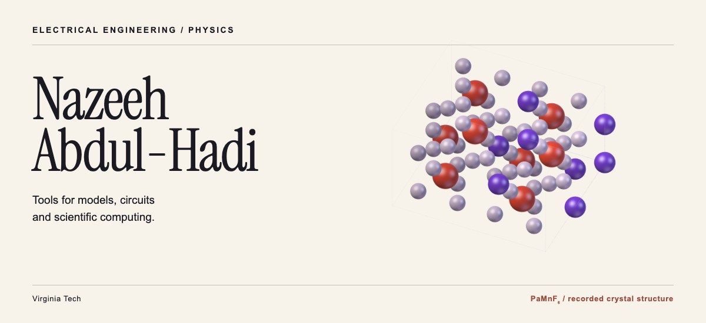
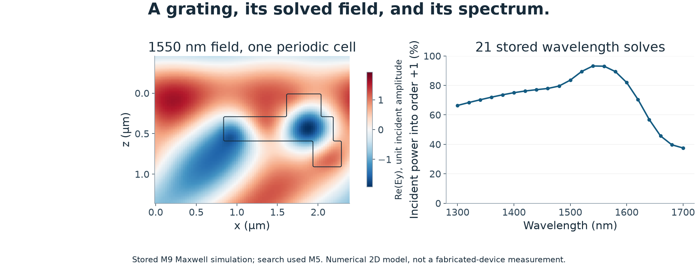

<a href="https://nazeeh111.github.io/"><picture><source media="(max-width: 600px)" srcset="assets/profile-v4/cover-mobile.png"></picture></a>

PaMnF₆ initial structure · 64 sites shown from eight periodic copies · [Model and data credits](assets/profile-v4/PROVENANCE.md)

I study electrical engineering and physics at Virginia Tech. I build tools for models, circuits and scientific computing.

[**Explore the portfolio**](https://nazeeh111.github.io/) &nbsp; · &nbsp; [Research](https://nazeeh111.github.io/research/) &nbsp; · &nbsp; [Engineering tour](START_HERE.md)

## From model to evidence

### [PhotonSmith](https://nazeeh111.github.io/work/photonsmith/) · Light through a designed structure

A periodic photonic grating, designed and checked with a Maxwell solver. The figure shows the retained electric field and spectrum from the numerical design, not a fabricated-device measurement.

<picture><source media="(max-width: 600px)" srcset="assets/profile-v3/photonsmith-mobile.png"></picture>

[Worked numerical design](https://github.com/nazeeh111/PhotonSmith/blob/a3ecad3af5f0bb957334f58f73379c886463aa42/docs/presentation/README.md) · [Source](https://github.com/nazeeh111/PhotonSmith) · [Figure provenance](assets/profile-v3/PROVENANCE.md)

### [Solidrift](https://nazeeh111.github.io/Solidrift/) · A union that lost a solid

A recorded Blender failure is reduced from 132 triangles to 12 while preserving the missing-body defect. The figure shows the original case; the linked walkthrough follows the reduction.

<picture><source media="(max-width: 600px)" srcset="assets/solidrift-comparison-mobile.svg"></picture>

[Follow the reduction](https://nazeeh111.github.io/Solidrift/) · [Source](https://github.com/nazeeh111/Solidrift) · [Fixture credits](assets/solidrift-comparison-provenance.md)

## More work

**[SiliconPilot](https://nazeeh111.github.io/work/siliconpilot/)** compiles a small neural classifier to fixed-point Verilog; compare recorded FPGA designs and simulated latency. [Circuits](https://nazeeh111.github.io/SILICONPILOT/) · [Source](https://github.com/nazeeh111/SILICONPILOT)

**[MaterialMind](https://nazeeh111.github.io/work/materialmind/)** compares crystal-stability predictions with archived DFT. In the recorded PaMnF6 case, the reference falls outside the stated prediction interval. [Worked case](https://github.com/nazeeh111/MaterialMind/blob/c879afa4b616649cac73ef46b010f24e12ed3544/docs/presentation/README.md)

**[MorphProof](https://nazeeh111.github.io/work/morphproof/)** translates supported numerical Python to Rust and exposes a deliberately omitted loop with a one-element input. [Compiler and Studio](https://github.com/nazeeh111/MorphProof)

**[LadderProof](https://nazeeh111.github.io/work/ladderproof/)** finds where an ideal resistor-ladder DAC can step backward and verifies tolerance bounds in the circuit model. [Source](https://github.com/nazeeh111/LadderProof)

[Browse all projects →](https://nazeeh111.github.io/work/)

## Research and contributions

[Two-copy quantum measurements](https://nazeeh111.github.io/research/phaseglass-quantum/): an exact result for a specified state family, with separate finite-shot simulations. [More research →](https://nazeeh111.github.io/research/)

- [PyVista](https://github.com/pyvista/pyvista/pull/9457): closed periodic seams in `ParametricKlein`.
- [Pattern Projector](https://github.com/Pattern-Projector/pattern-projector/pull/431): corrected viewport outlines under panning and projective transforms. Projection hardware was not tested.
- [GitHub advisory database](https://github.com/github/advisory-database/pull/9912): corrected Django package and affected-version mapping. [Advisory and credit](https://github.com/advisories/GHSA-wvqv-fj8w-qmhm).

[Engineering tour](START_HERE.md) · [Portfolio](https://nazeeh111.github.io/)
