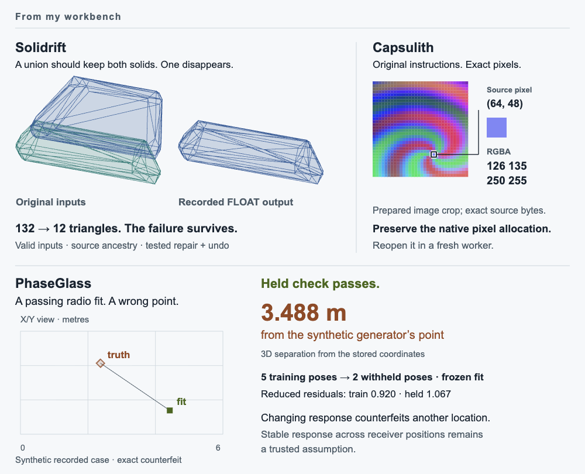

# Nazeeh Abdul-Hadi

I build systems software, geometry tools, and scientific instruments.

[Open the measured scene](https://nazeeh111.github.io/EchoSight/) · [Browse the project index](https://nazeeh111.github.io/)

[Choose a project: examples, code and evidence](START_HERE.md)

<picture>
  <source media="(max-width: 600px) and (prefers-color-scheme: dark)" srcset="assets/workbench-presentation-mobile-dark.png">
  <source media="(max-width: 600px) and (prefers-color-scheme: light)" srcset="assets/workbench-presentation-mobile-light.png">
  <source media="(prefers-color-scheme: dark)" srcset="assets/workbench-presentation-dark.png">
  
</picture>

Recorded runs, prepared pixels, and a synthetic radio experiment. [Image provenance](assets/workbench-presentation-provenance.md).

## Selected work

- **[EchoSight](https://github.com/nazeeh111/EchoSight):** Reconstruct published ultrasound measurements into inspectable volumes. [Measured scene](https://nazeeh111.github.io/EchoSight/) · [Evidence](https://github.com/nazeeh111/EchoSight/blob/backend/implementation/docs/MEASURED_NLOS.md).
- **[Solidrift](https://github.com/nazeeh111/Solidrift):** Reduce a recorded Blender failure to 12 triangles. [Demo](https://nazeeh111.github.io/Solidrift/).
- **[Capsulith](https://github.com/nazeeh111/Capsulith):** Run a compiled image codec in your browser. [Workbench](https://nazeeh111.github.io/Capsulith/studio/image.html).
- **[PhaseGlass](https://nazeeh111.github.io/Caustryn/demo/?case=exact-counterfeit):** Challenge a synthetic radio fit that passes at the wrong point.

More projects

- **[ObjectDNA](https://github.com/nazeeh111/ObjectDNA#quickstart):** Fit prealigned scans of brackets, open enclosures and drilled blocks.
- **[Keepstep](https://github.com/nazeeh111/SchemaRehearsal):** Compare the same workload before and after a SQLite migration. [Recorded search example](https://nazeeh111.github.io/SchemaRehearsal/).
- **[Rewynth](https://github.com/nazeeh111/Rewynth):** See why matching returns can hide a dropped memory write. [Browser state lesson](https://nazeeh111.github.io/Rewynth/lesson/).
- **[PhysicsBench](https://github.com/nazeeh111/PhysicsBench):** Explore acoustic models and motion experiments. [Live lab](https://nazeeh111.github.io/PhysicsBench/).
- **[LadderProof](https://github.com/nazeeh111/LadderProof):** Check exact step bounds for ideal 2–6-bit R-2R DACs.
- **[Kinetyl](https://nazeeh111.github.io/Kinetyl/):** Inspect and repair a label collision at 3.00 s.
- **[Enclose](https://github.com/nazeeh111/Certloom):** Check error bounds for stored linear systems independently of the solver.
- **[SolidFrame](https://nazeeh111.github.io/SolidFrame/):** Edit a part and export STEP or STL.

## Accepted contributions

- [PyVista](https://github.com/pyvista/pyvista/pull/9457): closed the periodic seams in `ParametricKlein`.
- [Pattern Projector](https://github.com/Pattern-Projector/pattern-projector/pull/431): viewport transforms and calibration. Projection hardware was not tested.
- [GitHub advisory database](https://github.com/github/advisory-database/pull/9912): corrected Django package and affected-version mapping. [Advisory and credit](https://github.com/advisories/GHSA-wvqv-fj8w-qmhm).
