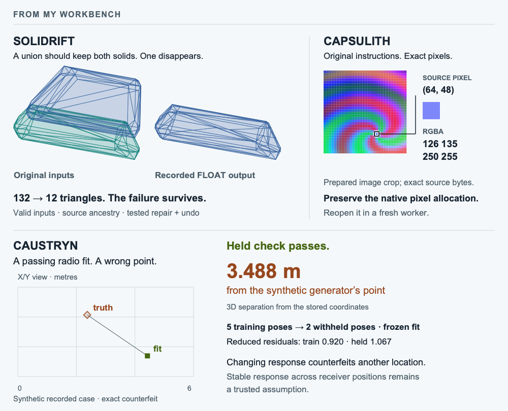

# A mesh, a pixel, a signal

I'm Nazeeh. I build systems software, geometry tools, and scientific workbenches. I like getting close to the details: the instructions behind a pixel, the topology behind a mesh failure, the assumption behind a radio fit.

**Open a working example:** [Inspect the missing-body case](https://nazeeh111.github.io/Solidrift/) · [Open the native image workbench](https://nazeeh111.github.io/Capsulith/studio/image.html) · [Investigate a passing counterfeit](https://nazeeh111.github.io/Caustryn/demo/?case=exact-counterfeit) · [Open PhysicsBench](https://nazeeh111.github.io/PhysicsBench/)

<picture>
  <source media="(max-width: 600px) and (prefers-color-scheme: dark)" srcset="assets/workbench-sensing-mobile-dark.png">
  <source media="(max-width: 600px) and (prefers-color-scheme: light)" srcset="assets/workbench-sensing-mobile-light.png">
  <source media="(prefers-color-scheme: dark)" srcset="assets/workbench-sensing-dark.png">
  
</picture>

*Three separate projects: a recorded geometry failure, prepared image bytes, and a synthetic radio fit that passes while missing its target. [Image sources](assets/workbench-provenance.md).*

## Inside the projects

- **Geometry · [Solidrift](https://github.com/nazeeh111/Solidrift):** reduce a recorded Blender failure from 132 to 12 triangles while keeping both inputs valid. Inspect mesh ancestry, repair and undo. New native runs use local Blender.
- **Systems · [Capsulith](https://github.com/nazeeh111/Capsulith):** run an original compiled image codec in your browser, inspect its returned pixels, and reopen initialized memory in a fresh worker.
- **Radio · [Caustryn](https://nazeeh111.github.io/Caustryn/demo/?case=exact-counterfeit):** a synthetic fit passes two held positions while missing the generator's point by 3.488 m. Inspect what the check proves and what it assumes.

Also explore:

- **SQLite · [SchemaRehearsal](https://github.com/nazeeh111/SchemaRehearsal):** replay writes and queries on before/after copies to catch migration behavior changes. [Run the search example](https://github.com/nazeeh111/SchemaRehearsal/blob/main/docs/full-text-search.md).
- **Ultrasound · [EchoSight](https://github.com/nazeeh111/EchoSight):** inspect a published measured NLOS reconstruction, native depth slices and threshold diagnostics, and reproduce the released Figure 2 input. [Open the measured scene](https://nazeeh111.github.io/EchoSight/) · [Evidence and limits](https://github.com/nazeeh111/EchoSight/blob/backend/implementation/docs/MEASURED_NLOS.md).
- **Physics · [PhysicsBench](https://github.com/nazeeh111/PhysicsBench):** test acoustic models against a separate probe, infer motion from image observations, and reopen records that recompute their results. [Open the live lab](https://nazeeh111.github.io/PhysicsBench/).
- **Electronics · [LadderProof](https://github.com/nazeeh111/LadderProof):** bound worst-case adjacent-code steps for ideal 2–6-bit R-2R DACs with exact arithmetic and independently recomputed certificates.
- **Motion · [Kinetyl](https://nazeeh111.github.io/Kinetyl/):** inspect a label collision at 3.00 s, compile the layout, and compare the repaired trajectory.
- **Numerical computing · [Certloom](https://github.com/nazeeh111/Certloom):** check linear-equation error bounds independently of the original solver.
- **CAD · [SolidFrame](https://nazeeh111.github.io/SolidFrame/):** edit plates and brackets in a browser, then export STEP and STL.

[Browse the project index →](https://nazeeh111.github.io/)

## Work accepted elsewhere

My [Pattern Projector viewport fix](https://github.com/Pattern-Projector/pattern-projector/pull/431) was merged across zoom, pan, rotation, reflection, and calibration; projection hardware was not tested. GitHub credited me as Analyst on an [advisory correction](https://github.com/github/advisory-database/pull/9912) to Django's package and affected-version mapping ([GHSA-wvqv-fj8w-qmhm](https://github.com/advisories/GHSA-wvqv-fj8w-qmhm)).
