# Nazeeh Abdul-Hadi

**I build across physics and software.**

I study electrical engineering and physics at Virginia Tech, and build tools that make models inspectable.

[Explore the portfolio](https://nazeeh111.github.io/) | [Take the engineering tour](START_HERE.md) | [Read the research](https://nazeeh111.github.io/research/)

## The union that lost a solid

**Solidrift reduces a recorded Blender failure from 132 triangles to 12**, preserving the missing-body defect at every accepted step.

<a href="https://nazeeh111.github.io/Solidrift/">
<picture>
  <source media="(max-width: 600px)" srcset="assets/solidrift-comparison-mobile.svg">
  
</picture>
</a>

[Follow the reduction](https://nazeeh111.github.io/Solidrift/) | [Inspect the code and evidence](https://github.com/nazeeh111/Solidrift)

The figure shows the original 132-triangle case, not the reduced witness. [Figure source and fixture credits](assets/solidrift-comparison-provenance.md).

## Find your field

**Geometry you can work with**  
[SolidFrame](https://github.com/nazeeh111/SolidFrame): browser CAD built on Chili3D, with editable mechanical parts and STEP/STL export. [Open CAD](https://nazeeh111.github.io/SolidFrame/).

**Physics made inspectable**  
[EchoSight](https://github.com/nazeeh111/EchoSight): an attributed reconstruction from published ultrasound measurements. [Explore the measured case](https://nazeeh111.github.io/EchoSight/). [QLOOM](https://github.com/nazeeh111/QLOOM): quantum circuit compilation with independent numerical checks.

**Systems with state that matters**  
[Capsulith](https://github.com/nazeeh111/Capsulith): prepared ARM64 image code with preserved pixel allocation. [Run the workbench](https://nazeeh111.github.io/Capsulith/studio/image.html). [Rewynth](https://github.com/nazeeh111/Rewynth): the memory changes a return value can miss.

**Models with explicit assumptions**  
[LadderProof](https://github.com/nazeeh111/LadderProof): exact tolerance bounds for ideal resistor-ladder DACs. [MaterialMind](https://github.com/nazeeh111/MaterialMind): crystal features, stability models and retrospective active-learning experiments.

**Tools for doing the work**  
[nstack](https://github.com/nazeeh111/nstack): reviewed specialist tools in a native Mac coding setup.

## Research you can inspect

**Can two copies reveal what purity tests miss?** [The two-copy quantum measurement study](https://nazeeh111.github.io/research/phaseglass-quantum/) gives an exact result for a specified state family, plus a separate finite-shot simulation. [More studies, methods and limits](https://nazeeh111.github.io/research/).

## Contributions accepted upstream

- [PyVista](https://github.com/pyvista/pyvista/pull/9457): closed periodic seams in `ParametricKlein`.
- [Pattern Projector](https://github.com/Pattern-Projector/pattern-projector/pull/431): viewport transforms and calibration fixes. Projection hardware was not tested.
- [GitHub advisory database](https://github.com/github/advisory-database/pull/9912): corrected Django package and affected-version mapping. [Advisory and credit](https://github.com/advisories/GHSA-wvqv-fj8w-qmhm).

[Look closer at the engineering](START_HERE.md) for fixed-revision source links, reproduction paths and the boundaries of each result.

Profile source and checks

Run `python3 scripts/check_profile.py` from any working directory, using the script's full path when outside this checkout. It checks local inline Markdown and HTML references, the current image-to-provenance map in `profile-assets.json`, SVG descriptions and fixed-revision GitHub source-link syntax. Inline links support simple labels, balanced or angle-bracketed destinations and quoted or parenthesized titles. Reference-style links, autolinks and Markdown code-block interpretation are outside this small lint rule. It runs offline without dependencies and does not verify remote availability, rendered appearance or the scientific claims. Update the map and the credited provenance note together when replacing a current image. Historical artwork stays in `assets/`.

