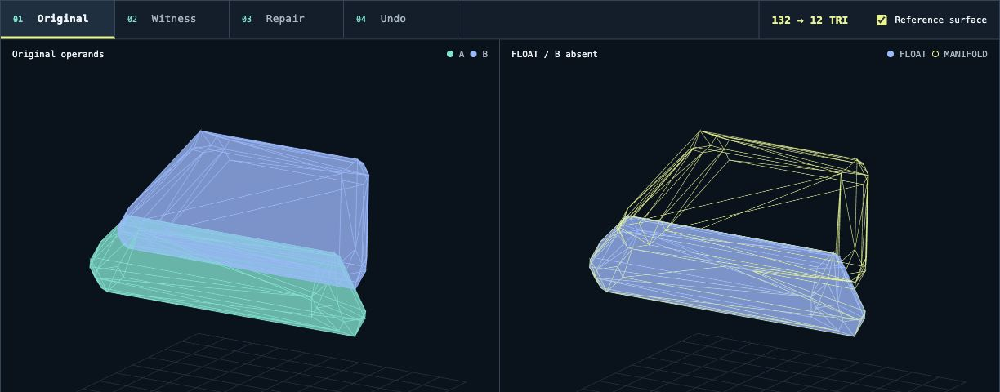
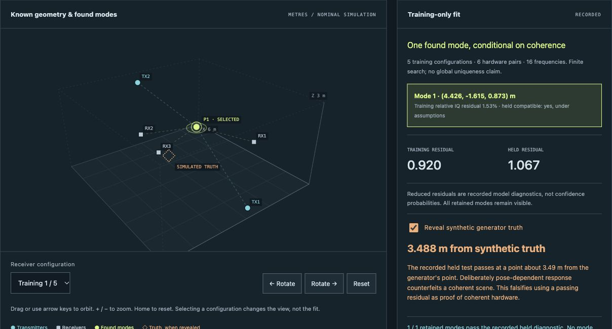

# I build things that show their work.

I'm Nazeeh Abdul-Hadi. I build tools that expose a hidden mistake: a missing mesh body, a program taking the wrong branch, or a radio fit that passes the wrong test. Open a case, change the view, and see what survives.

[Browse the interactive project index](https://nazeeh111.github.io/) · [See every repository](https://github.com/nazeeh111?tab=repositories)

## Start with a broken mesh

**A Boolean union dropped one input.** [Open the interactive case](https://nazeeh111.github.io/Solidrift/) · [Watch the 19-second tour](https://nazeeh111.github.io/Solidrift/tour.html)

**132 triangles → a 12-triangle witness.** Step through 60 accepted reductions, follow the witness back to the full model, inspect a tested input repair, then undo it. The geometry and Boolean outputs come from a recorded native run; the browser is an explorer. [Source and limits](https://github.com/nazeeh111/Solidrift).

## Pick a question

**Can compiled code outlive its original host?** [Try Capsulith's image workbench](https://nazeeh111.github.io/Capsulith/studio/image.html): decode an image with a prepared ARM64 function and inspect its returned pixels and preserved memory. [Source and scope](https://github.com/nazeeh111/Capsulith).

**Can a failed program take a different path?** [Explore Aetiory's recorded diagnosis](https://nazeeh111.github.io/Aetiory/): change an earlier Python return and compare the two retained outcomes. Live forking runs locally. [Source](https://github.com/nazeeh111/Aetiory).

**Can a good fit still be false?** [Open Caustryn's exact counterfeit](https://nazeeh111.github.io/Caustryn/demo/?case=exact-counterfeit): a held-position check passes at a point **3.488 m from synthetic truth**. Reveal the generator's truth to inspect the counterexample. This tests an assumption, not real-world sensing accuracy. [Source](https://github.com/nazeeh111/Caustryn).

## More to open

- **Recover execution:** [Forkwake](https://github.com/nazeeh111/Forkwake#run-it) saves a live JavaScript or WebAssembly decision; [Rewynth](https://github.com/nazeeh111/Rewynth#run-it) tests ARM64 return values and bounded memory.
- **Measure what is hidden:** [EchoSight](https://github.com/nazeeh111/EchoSight/blob/backend/implementation/docs/MEASURED_NLOS.md) reconstructs published ultrasound measurements; [WiPose](https://github.com/nazeeh111/WiPose) separates recorded Wi-Fi inference from a hardware-free demo.
- **Carry the check:** [Certloom](https://nazeeh111.github.io/Certloom/) checks exact numerical bounds; [SchemaRehearsal](https://github.com/nazeeh111/SchemaRehearsal#keep-search-working-after-a-migration) replays app behavior across SQLite migrations.
- **Build and learn:** [SolidFrame](https://nazeeh111.github.io/SolidFrame/) is an interactive CAD workbench; [Syllune](https://nazeeh111.github.io/Syllune/) is a private math studio. [Find more live and local projects](https://nazeeh111.github.io/).

## Elsewhere in open source

- [Pattern Projector #431](https://github.com/Pattern-Projector/pattern-projector/pull/431): merged viewport-outline fix for zoom, pan, rotation, reflection, and calibration. Projection hardware was not tested.
- [awesome-sqlite #10](https://github.com/Airsequel/awesome-sqlite/pull/10): merged Tools-list and contribution-format improvement after maintainer review.
- [GitHub advisory GHSA-wvqv-fj8w-qmhm](https://github.com/advisories/GHSA-wvqv-fj8w-qmhm): credited as Analyst for correcting the Django package and affected-version mapping. [Accepted change](https://github.com/github/advisory-database/pull/9912).
*Projects distinguish recorded, simulated and native results in their own evidence and limits. Start with a case here, then use the [project index](https://nazeeh111.github.io/) to choose another.*
